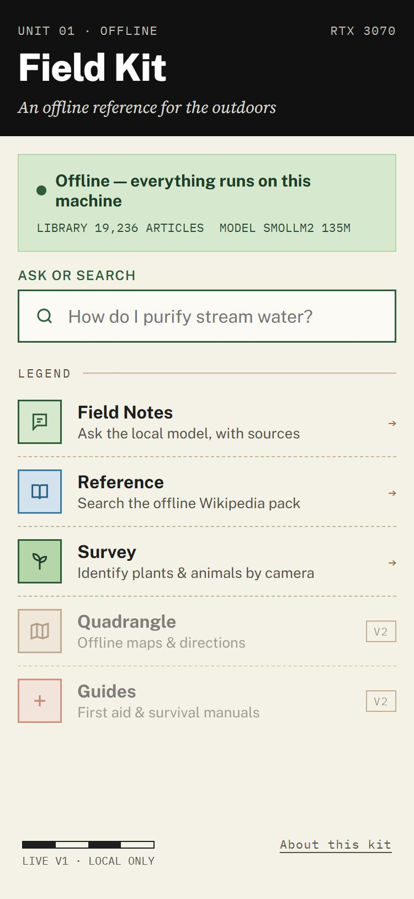
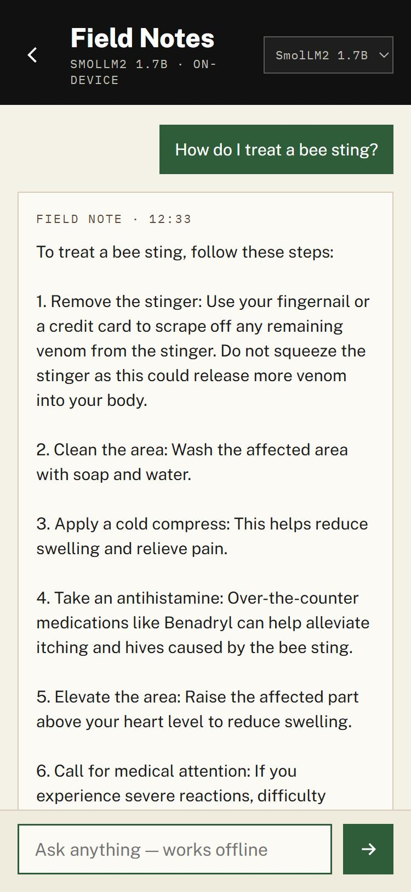
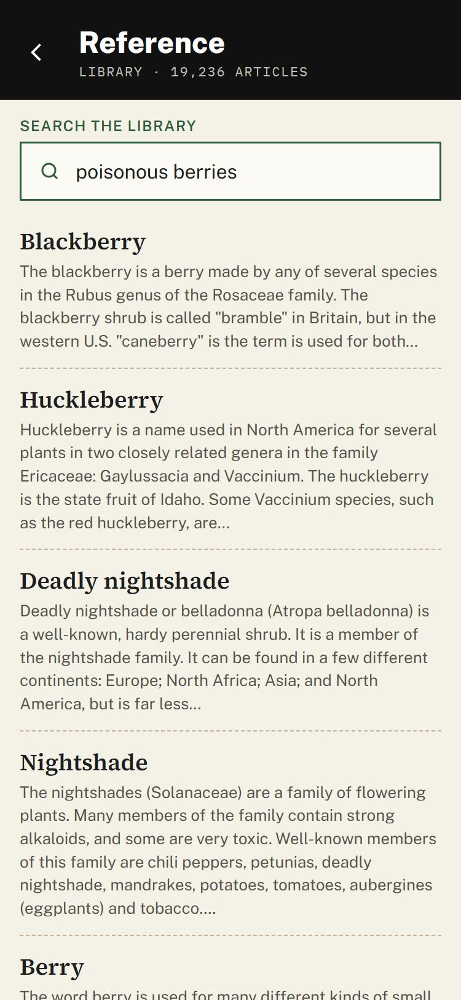
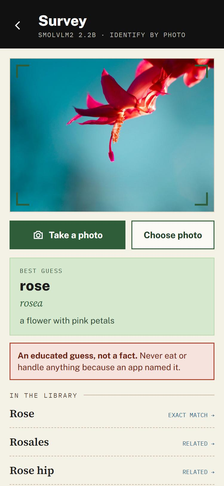
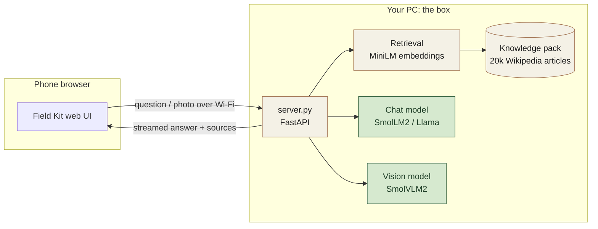
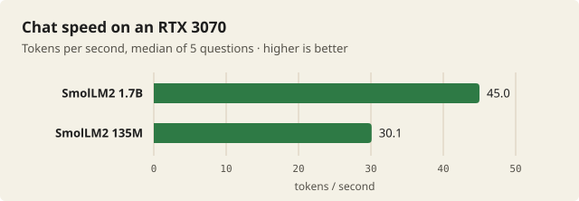
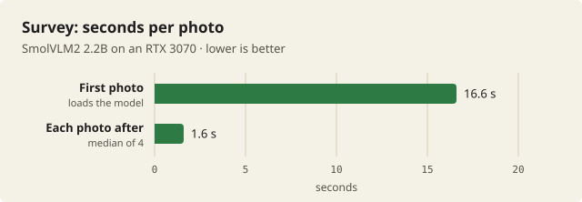
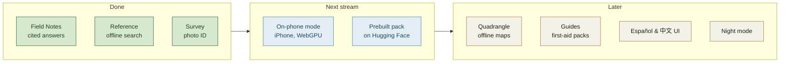

# Field Kit — Offline Knowledge Box

An open-source, fully offline question-answering box, built live on stream for Hacktoberfest 2026.
A small **open-weight model** answers from a **local knowledge pack** built from Simple English
Wikipedia. It runs **natively on Windows** (no Docker, no WSL, no Ollama): Python + transformers
on the GPU, with a phone-first web UI in the *Field Kit* style (US-map palette: map paper,
public-land mint, forest ink, road red for danger only).

Your PC is the box: it runs the models and the search. Any phone on the same Wi‑Fi opens the UI in
its browser. Running the model on the phone itself is a goal for a future stream.

| Home | Field Notes | Reference | Survey |
|---|---|---|---|
|  |  |  |  |
| Status, ask box, tools | Answers with sources | Offline Wikipedia search | Identify by photo |

## How it works



1. **Ask:** the question is embedded and matched against ~60k chunks of Simple English Wikipedia.
2. **Answer:** the best 4 chunks go to the chat model, and the answer streams back with numbered
   sources you can open in Reference.
3. **Survey:** a photo goes to the vision model, and its guess is looked up in the same library.
4. **Offline:** once models and the pack are downloaded, nothing leaves the PC.

## Run it

```powershell
.\run.ps1
```

On the first run it creates a Python env (if needed), builds the knowledge pack (20k articles, a
few minutes on a GPU) and serves http://localhost:8080. It also prints the address to use from a
phone on the same Wi‑Fi. To let the phone in, allow port 8080 in Windows Firewall.

| Flag | What it does |
|---|---|
| `-Ingest` | Rebuild the knowledge pack |
| `-MaxDocs 5000` | Smaller pack, faster to build |
| `-Model smollm2-135m` | Start with a different chat model: `smollm2-135m`, `smollm2-1.7b` (default) or `llama3.1-8b` |

You can also switch models in the Field Notes header. The server keeps one model on the GPU at a time.

## Models

| Key | Model | Open-ness | Notes |
|---|---|---|---|
| `smollm2-135m` | HuggingFaceTB/SmolLM2-135M-Instruct | Fully open | Instant, but weak |
| `smollm2-1.7b` | HuggingFaceTB/SmolLM2-1.7B-Instruct | Fully open | Default; good for a demo |
| `llama3.1-8b` | meta-llama/Llama-3.1-8B-Instruct | Open weights (Llama license) | Gated: accept the license on Hugging Face and `huggingface-cli login` first. Loaded 4-bit (~6 GB VRAM) |
| Survey | HuggingFaceTB/SmolVLM2-2.2B-Instruct | Fully open | Vision model for photo ID |

Embeddings: `sentence-transformers/all-MiniLM-L6-v2`. Knowledge: `wikimedia/wikipedia` (`20231101.simple`).

## What's in it

- **Home**: status (library size, GPU, model), ask box, legend of tools.
- **Field Notes**: streamed answers grounded in the library, numbered citations, source chips, tok/s.
- **Reference**: semantic search over the pack and an offline article reader.
- **Survey**: take a photo and a small vision model guesses what it is, then looks it up in the
  library.

## Survey

Identify plants, animals, insects and fungi from a photo.

1. **On the phone:** tap *Take a photo* (opens the rear camera) or *Choose photo*. The browser
   shrinks the image to 1024 px before sending it, so uploads are small over Wi‑Fi.
2. **On the PC:** [SmolVLM2 2.2B](https://huggingface.co/HuggingFaceTB/SmolVLM2-2.2B-Instruct)
   answers in a fixed `NAME / SCIENTIFIC / FEATURES` format.
3. **Lookup:** the guess is searched in the knowledge pack. An article whose title matches the name
   is marked **EXACT MATCH**; the others are **RELATED**. *Ask about this* hands the guess to
   Field Notes.

On an RTX 3070 the first photo takes about 17 s while the model loads, then under 2 s each (see
[Performance](#performance)). Chat and vision models share the GPU one at a time, so switching between Survey and Field Notes
reloads a model.

**Be honest about it on stream:** a 2.2B model is often confidently wrong. In testing, a Christmas
cactus came back as "rose". That's why every result carries the warning and links the library
article to check against.

Technical notes:
- Needs `torchvision` (installed by `run.ps1`) and `num2words`.
- `server.py` patches `SmolVLMModel.inputs_merger` for transformers 5.x, which groups image tokens
  by the vision patch size (14) instead of tokens per image tile (81) and fails on every image.
  The patch can go once transformers fixes it upstream.

## Performance

Measured on the stream PC (RTX 3070, 8 GB) against the running server, 19 October 2026.





| Measure | SmolLM2 135M | SmolLM2 1.7B | SmolVLM2 2.2B (Survey) |
|---|---|---|---|
| Speed (median, 5 questions) | 30.1 tok/s | 45.0 tok/s | — |
| Time to first words | 2.3 s | 2.4 s | — |
| Full answer | 4.7 s | 7.2 s | — |
| First photo (loads model) | — | — | 16.6 s |
| Each photo after (median of 4) | — | — | 1.6 s |

Yes, the 135M model is *slower* per token than the 1.7B. It's so small that Python overhead per
token, not the GPU, sets the pace. Llama 3.1 8B isn't measured yet (it needs a Hugging Face login).
Your numbers will differ by GPU; PRs with other hardware are welcome.

## Roadmap



**Done**
- [x] Field Notes: streamed answers grounded in the library, with source chips
- [x] Reference: semantic search and an offline article reader
- [x] Survey: photo ID with SmolVLM2, checked against the library
- [x] Phone access over Wi‑Fi

**Next stream**
- [ ] On-phone mode: run a small model in the iPhone's browser (WebGPU + transformers.js), no PC needed
- [ ] Publish the prebuilt knowledge pack as a Hugging Face dataset and add `run.ps1 -Download`

**Later**
- [ ] Quadrangle: offline maps from an OpenStreetMap extract
- [ ] Guides: first-aid and survival packs from openly licensed sources
- [ ] Spanish and Chinese UI (designs exist), night mode, ruler and compass
- [ ] Benchmark Llama 3.1 8B and other GPUs

**Good first issues**
- [ ] The Field Notes header says "ON-DEVICE", but the model runs on the PC; make the label say so
- [ ] Small models often skip `[1]` citations: try prompt changes and report what works
- [ ] Add a knowledge pack for another language (for example Spanish Wikipedia)

## Files

| File | What it is |
|---|---|
| `run.ps1` | One-command setup and start |
| `server.py` | FastAPI server: retrieval, chat, survey, article API |
| `ingest.py` | Builds the knowledge pack into `data/` |
| `static/index.html` | The whole web UI |
| `docs/` | Screenshots and charts for this README |

API: `GET /api/status` · `POST /api/ask` (NDJSON stream: `sources`, `delta`…, `done`) ·
`GET /api/search?q=` · `GET /api/article?title=` · `POST /api/survey`

## Attribution

Knowledge pack content comes from Wikipedia under [CC BY-SA 4.0](https://creativecommons.org/licenses/by-sa/4.0/).
Each answer links the articles it used. Models and datasets keep their own licenses; check each
Hugging Face model card.

## Safety

This is a reference tool, not medical, legal or emergency advice. Answers come from a small model
and a partial encyclopedia, so check anything important. Never eat or handle anything because an
app named it.

## License

MIT for code.
