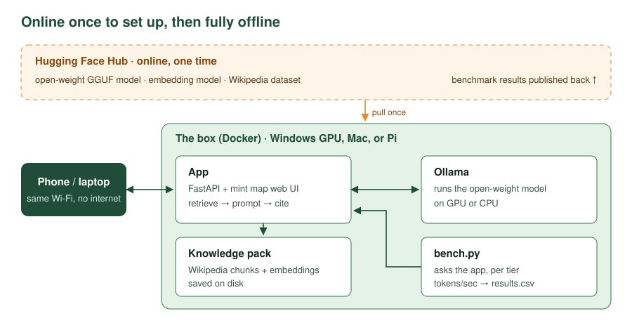

# Offline Knowledge Box

An open-source, fully offline question-answering box: an **open-weight model** (run by Ollama) answers from a **local knowledge pack** built from Hugging Face datasets. One Docker image runs on a Windows GPU desktop, a Mac, or a Raspberry Pi. Ask questions from any phone on the same Wi‑Fi — no internet required once it's set up.

Built live for Hacktoberfest 2026, whose theme is open source and open-weight AI.



## The end goal

When the build is done you have:

- [ ] **A box that answers with the internet off.** Unplug the router, ask a question from your phone, get an answer.
- [ ] **Answers that cite their sources.** Every answer links the Wikipedia articles it drew on, so you can check it.
- [ ] **A model you can swap in one line.** Change `CHAT_MODEL` to any GGUF model on the Hugging Face Hub, no code changes.
- [ ] **The same image on three tiers.** A GPU desktop, a laptop, and a Pi-like container, with benchmark numbers for each.
- [ ] **Something given back.** A public repo, a public Hugging Face dataset of benchmark results, and open issues for contributors.

What a finished answer looks like on the phone:

```
Q: How do I purify water without a filter?
A: Bring it to a rolling boil for at least one minute [1]. If you can't boil it,
   household bleach can be used in small measured amounts [2] ...
   [1] Water purification · [2] Portable water purification
   olmo · 42.1 tok/s
```
*(Illustrative example of the format, not real output.)*

## How it works

1. **Online, one time:** pull an open-weight model, an embedding model, and a Wikipedia dataset from the Hugging Face Hub.
2. **Ingest:** split articles into chunks, embed them, and save the knowledge pack to disk.
3. **Ask:** the app finds the closest chunks, hands them to the model through Ollama, and returns an answer with numbered citations.
4. **Offline from here on:** nothing leaves the box.

## Choosing a model: how open is open?

"Open" covers a range. Before you set `CHAT_MODEL`, check the model card on Hugging Face:

| Level | What you get | Example |
|---|---|---|
| Open weights, restricted license | Download and run, with license conditions | Llama (Community License) |
| Open weights, permissive license | Use, modify, redistribute | Mistral 7B (Apache 2.0) |
| Fully open | Weights + training data + training code | OLMo (AI2), SmolLM (Hugging Face) |

This project prefers the most open model that does the job. The Open Source Initiative's [Open Source AI Definition](https://opensource.org/ai/open-source-ai-definition) is the reference for what "open source" means for AI. Licenses change, so always check the current model card.

## The open stack

| Part | Project | License |
|---|---|---|
| Model runtime | Ollama / llama.cpp | MIT |
| Embeddings | sentence-transformers | Apache 2.0 |
| API | FastAPI | MIT |
| Datasets | Hugging Face `datasets` | Apache 2.0 |
| Knowledge | Wikipedia | CC BY-SA 4.0 (attribution required) |
| This repo | Offline Knowledge Box | MIT |

No API keys, no cloud calls, no closed models in the runtime path.

## Quick start

```bash
cp .env.example .env
docker compose up -d --build                     # add -f docker-compose.gpu.yml for NVIDIA
./scripts/pull-models.sh                         # pulls CHAT_MODEL from Hugging Face
docker compose run --rm app python ingest.py     # builds the knowledge pack (one time)
docker compose restart app
```

Open http://localhost:8080, or `http://<box-ip>:8080` from your phone.

### Tiers

| Tier | Command | Suggested model size |
|---|---|---|
| GPU (Windows + WSL2, NVIDIA) | `docker compose -f docker-compose.yml -f docker-compose.gpu.yml up -d` | 7–14B+ |
| Mac / laptop CPU | `docker compose up -d` | 3–8B |
| Pi-like (CPU/RAM capped) | `docker compose -f docker-compose.yml -f docker-compose.pilike.yml up -d` | 1–4B, Q4 |

The Pi-like tier caps resources only. It approximates a Pi, so its results are labeled "Pi-like."

### Windows notes
- Install WSL2 and Docker Desktop. Keep the repo inside the WSL filesystem (`~/`), not `C:\`.
- Check that the GPU is visible: `docker run --rm --gpus all nvidia/cuda:12.4.1-base-ubuntu22.04 nvidia-smi`
- To reach the UI from your phone, allow port 8080 in Windows Firewall.

### Multi-arch build (amd64 + arm64)
```bash
docker buildx build --platform linux/amd64,linux/arm64 -t <you>/okb-app:latest --push ./app
```

## Benchmark

```bash
pip install httpx huggingface_hub
python bench/bench.py --tier gpu --models hf.co/bartowski/Llama-3.2-3B-Instruct-GGUF:Q4_K_M <another-gguf>
python bench/bench.py --tier pi-like --push      # optional: publish results as a HF dataset
```

Results append to `bench/results.csv`, including speed, latency, answers, and the sources used, so you can review answer quality alongside speed.

## Contributing

Good first issues to open during the stream:

- Add a knowledge pack for another language (for example Spanish Wikipedia)
- Test the box on a real Raspberry Pi 5 and add its benchmark row
- Add an offline maps pack (OpenStreetMap extract)
- Add a first-aid and survival knowledge pack from openly licensed sources
- Add a model picker to the web UI

## Attribution

Knowledge pack content comes from Wikipedia and is licensed under [CC BY-SA 4.0](https://creativecommons.org/licenses/by-sa/4.0/). Each answer links the articles it used. Models and datasets keep their own licenses; see each Hugging Face model card.

## Safety

This is a reference tool. It is not medical, legal, or emergency advice. Answers come from a small model and a partial encyclopedia, so check anything important.

## License

MIT for code. Models and datasets keep their own licenses; check each Hugging Face model card.
